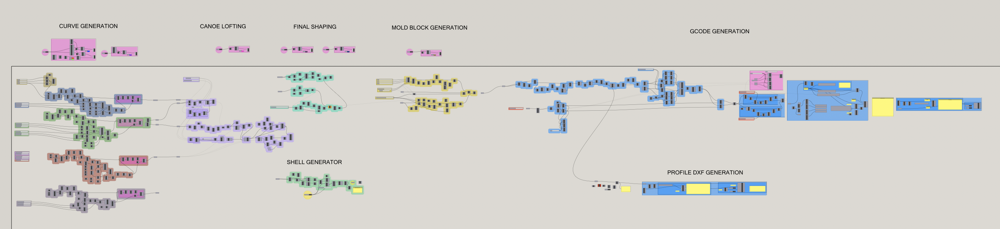
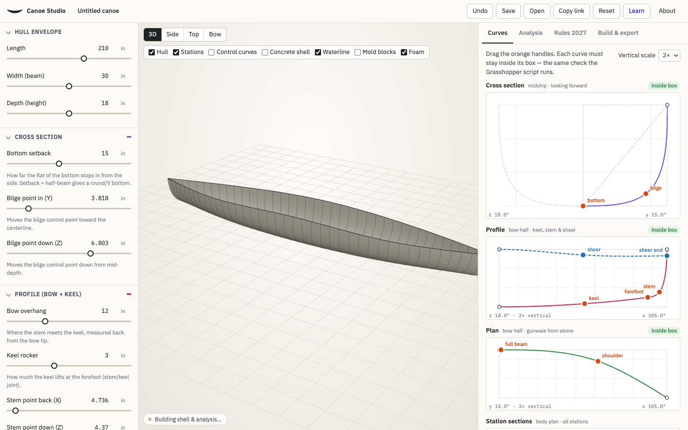
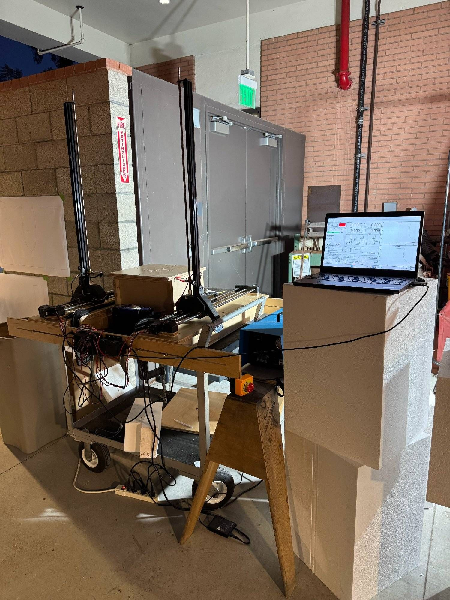
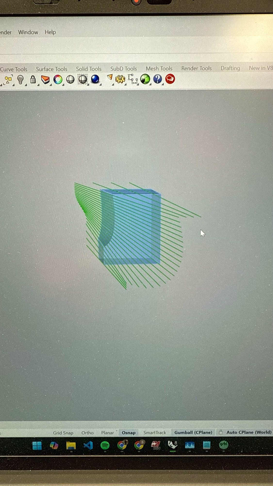
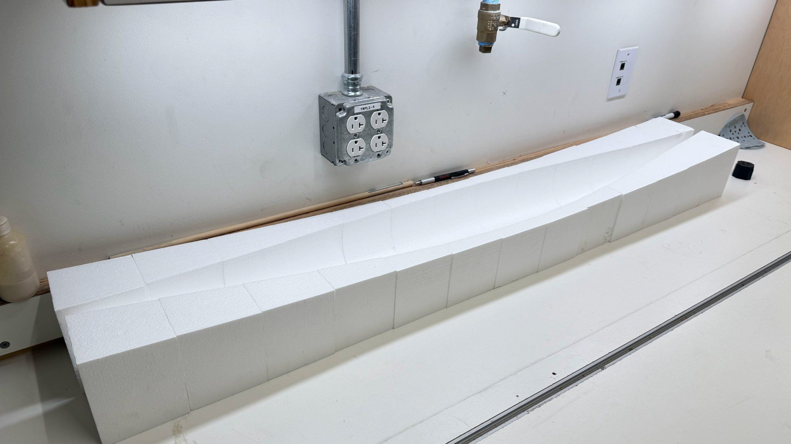
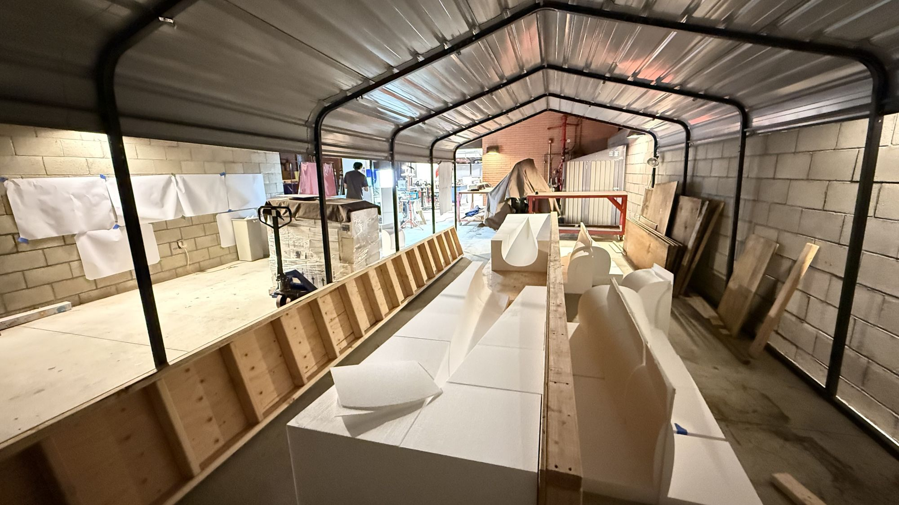
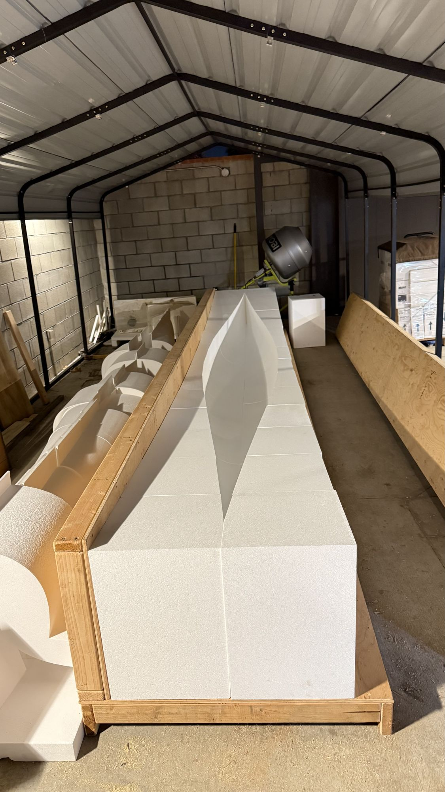
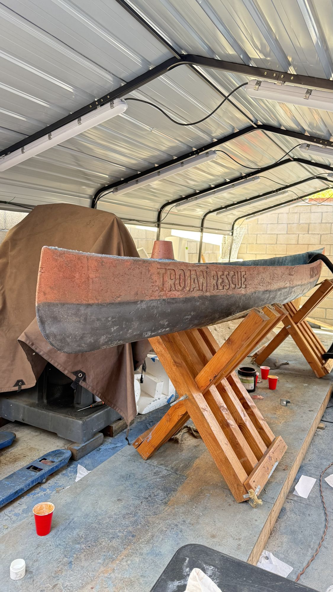

# Concrete Canoe Mold Generator

A parametric Grasshopper definition that designs a concrete canoe hull from three control curves, turns it into a
stack of EPS foam mold blocks, and writes the g-code to cut each block on a 4-axis CNC hotwire cutter. Built for the USC
ASCE Concrete Canoe team.



**Web version:** Will Rollins turned this script into a web-based version, built with Claude:
[Canoe Studio](https://shopnerd.github.io/canoe-studio/). Same idea in the browser: drag the curves, see the hull and the
mold blocks update, and export.



## Requirements

- Rhino 8 with Grasshopper (the file was saved in Grasshopper 8.27)
- Plugins: [Pufferfish](https://www.food4rhino.com/en/app/pufferfish) (tween curves),
  OCORE Toolbox and [Pancake](https://www.food4rhino.com/en/app/pancake) (file export)

Open Rhino, run `Grasshopper`, then open `canoe_script_012326.gh`. Everything is driven by sliders and curve controls on
the left of the canvas; the previews show up in the Rhino viewport.

## How it works

The definition runs left to right in five stages: **shape the hull → build the shell → place it in the foam → cut the
blocks → write the g-code.**

### 1. Shape the hull with three curves

A canoe hull is defined by three curves, each with its own group of controls:

| Curve | What it sets | Controls |
|---|---|---|
| **Top curve** | The gunwale seen from above: how the beam narrows from midship to the bow | `top curve controls` |
| **Forward curve** | The profile seen from the side: keel, stem and how the bow rises | `forward curve controls`, `top rocker control`, `bottom rocker control`, `rocker Z offset` |
| **Cross section** | The midship section: flat bottom, bilge turn and sides | `cross section curve controls`, `bottom setback`, `midpoint setback X / Y / Z` |

`bottom setback` sets how far the flat of the bottom stops in from the side, and the midpoint setbacks move the bilge
control point. `canoe end chop` and `trim back` set how the ends are cut off, and `canoe smoothness control` sets how
many sections the hull is built from.

### 2. Build the shell

The cross section is tweened toward the forward curve (Pufferfish **Tween Curve**), giving a family of section curves
from midship to the bow. Each section is then rotated, dropped to the keel line (`position tweens to bottom`) and scaled
so its top lands exactly on the top curve (`scale to match top curve`, `extend tween to top curve`).

The sections are lofted into one surface, mirrored to make the full hull, capped and joined (`canoe solid`).
`shell wall thickness` offsets it into the concrete `canoe shell`, and volume and area are computed for checking weight
and buoyancy.

### 3. Place the canoe in the foam

`place canoe` positions the hull inside the foam stock with offsets from the block bottom (`canoe x offset`,
`canoe Z offset`), and `top trim` sets where the mold is cut off at the gunwale.

### 4. Cut it into mold blocks

`make blocks` lays out a grid of foam blocks from `block sizes`, `num rows` and `num blocks per row` (a rectangular
array) and subtracts the canoe from the foam (`trim blocks`, a solid difference). What is left is the male mold, split into blocks the size of the foam you actually have.

### 5. Write the g-code

Each block's two faces are different hull sections, which is why the cutter needs four axes: one tower at each end of
the wire, each moving on its own, so the wire sweeps the surface between the two profiles.

For each selected block (`select blocks`, `move blocks to origin`), the script finds the cutting edge on both faces
(`find cutting edge`, `create trim planes`, `extend and trim to planes`) and pairs them into `machine cut lines`. Those
are turned into synchronized moves for the two towers, one line per point:

```
G01 X{x} Y{y} A{a} Z{z}
```

X/Y drive one tower and A/Z the other. `machine settings` holds the `wire length`, the feed rates (`F1000`, and `F750`
to start a cut) and safe moves before and after each block (`safe start from block`, `safe end from block`).
`add gcode headers` wraps each program, `create filenames` names it per block, and `export to files` writes them out.
Block contours can also be exported as DXF (`export block contours as dxf`).

Previews let you check each stage before cutting: `canoe contours preview`, `canoe guide contours preview`,
`mold blocks preview`, `preview trim planes`, `visualize cut lines`, `gcode preview` and `drawing validation preview`.

## From script to canoe




A small test mold came first, then the full-size blocks.






Written up by USC Viterbi:
[How to design a competitive concrete canoe](https://viterbischool.usc.edu/news/2025/05/how-to-design-a-competitive-concrete-canoe/).

## Files

- `canoe_script_012326.gh`: the Grasshopper definition
- `images/`: canvas, web version and build photos
