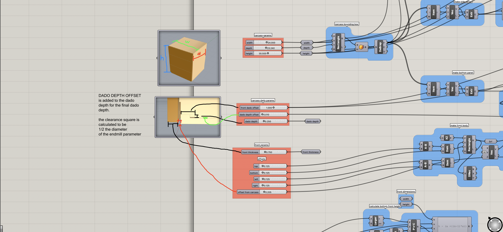

# Grasshopper

Parametric Grasshopper definitions for Rhino 8 that take a design from a few inputs all the way to parts a machine can
cut.

| Project | What it does |
|---|---|
| [**Concrete canoe mold generator**](canoe-mold/) | Designs a concrete canoe hull from three control curves, splits it into EPS foam mold blocks and writes 4-axis hotwire g-code for each block. |
| [**Parametric cabinet**](parametric-cabinet/) | Generates a complete plywood cabinet (carcass, drawers, doors, dados and hardware holes) as flat parts ready for a CNC router. |

Both have web versions by Will Rollins: [Canoe Studio](https://shopnerd.github.io/canoe-studio/) (built with Claude)
and [Cabinet Maker](https://will.100xbtr.com/cabinet/).

Each folder has its own README with requirements, inputs and how each stage works.
