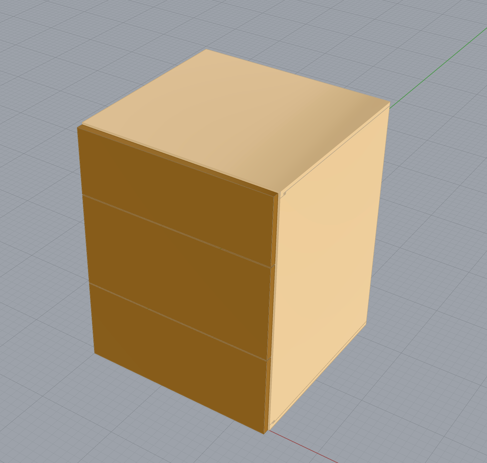
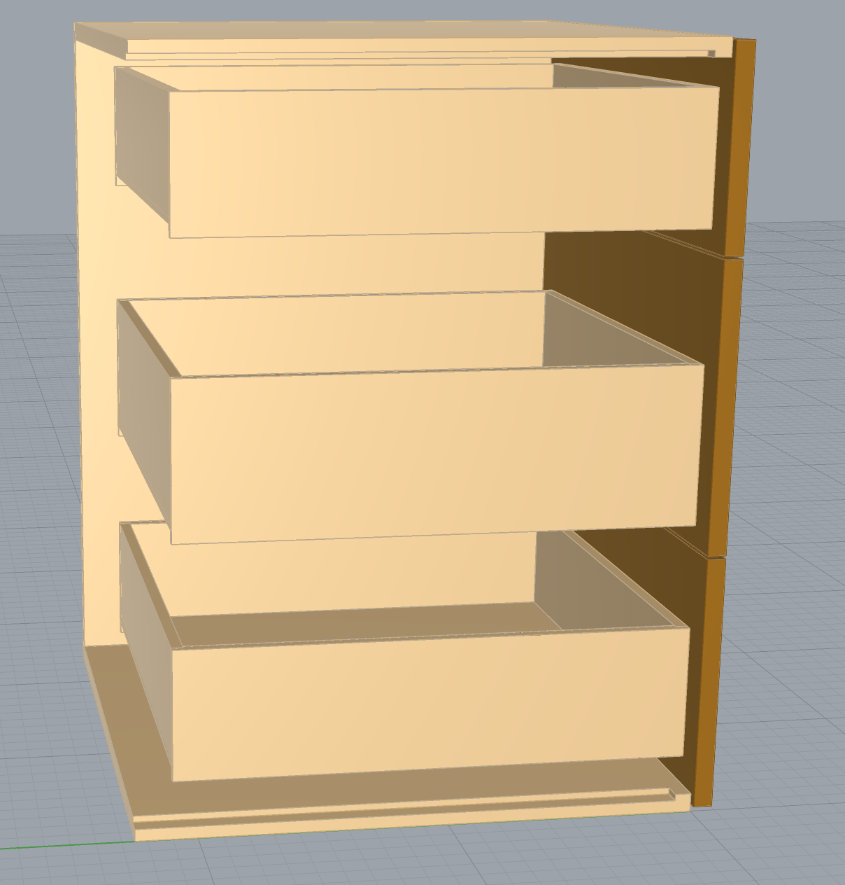
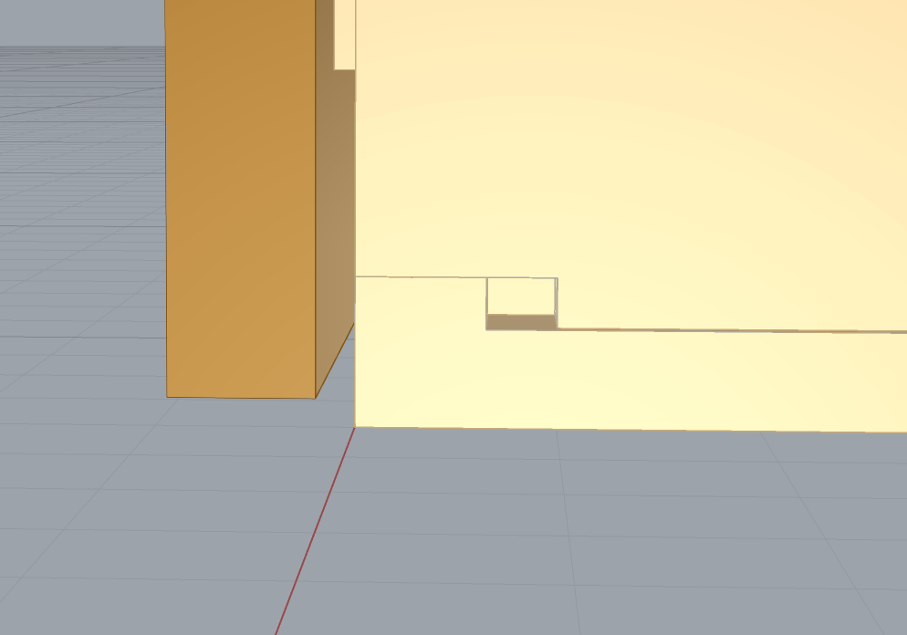

# Parametric Cabinet

[← all Grasshopper projects](../)

A Grasshopper definition that generates a complete plywood cabinet, carcass, drawers, doors and all the holes, from a
few dimensions. Every part is generated flat and ready to cut on a CNC router, with the joinery, clearances and tooling
built in.

## Requirements

- Rhino 8 with Grasshopper
- [EleFront](https://www.food4rhino.com/en/app/elefront) plugin (used to bake the parts out)

Open Rhino, run `Grasshopper`, then open `parametric_cab_090825.gh`. Every input is a slider in a labeled params group
on the left of the canvas.

## Inputs

| Group | Sliders |
|---|---|
| **carcass params** | `width`, `height`, `depth` |
| **material params** | `ply thickness`, `front thickness` |
| **tooling params** | `endmill diameter` |
| **carcass dado params** | `dado depth`, `front dado offset`, `dado depth offset` |
| **front params** | `top`, `bottom`, `left`, `right` offsets, `offset from carcass` |
| **front spacing params** | `front spacing`, `num drawers`, `num doors`, `front height` and `drawer height` per drawer |
| **drawer params** | `wall thickness`, `bottom thickness`, `drawer depth`, `wall dado depth`, `bottom dado depth`, `bottom dado clearance` |
| **drawer box offsets** | `bottom offset`, `side offset`, `z-offset`, from the carcass and from the front |
| **hardware** | hinge `pocket diameter`, `pocket depth`, `hole offset from pocket`, `screw hole diameter` and `depth`; hole `num holes`, `hole spacing`, `hole diameter`, `hole depth` for shelf pins and slides |

## How it works

### 1. Carcass

The carcass is built from its bounding box. The script makes the left, right, top, bottom and back panels at the ply
thickness (`make bottom panel`, `make back`), finds the dado edges where panels meet (`find dado edge`) and cuts the dados
into them (`make dado cut`, `dado body`). Panels are mirrored across the mid planes so both sides match.

### 2. Fronts

`front dimensions` sizes the fronts from the carcass with an offset on each side and a `front spacing` gap between them.
`num drawers` and `num doors` decide how the front is split: `create split blocks` cuts it into individual drawer and
door fronts (`cut fronts`), and `calculate bottom front height` gives the bottom front whatever height is left.
`top drawer`, `middle drawer` and `bottom drawer` can each be customized.

### 3. Drawers

Each drawer front gets a box behind it (`create drawer frames`, `drawer boxes`). The box is offset from the front and
from the carcass walls to leave room for the slides, the walls are dadoed, and the bottom sits in its own dado
(`make bottom`, `make boolean bottom`). Notes on the canvas explain the clearances: `bottom dado clearance` is added to the
dado so the bottom can slide in, and a clearance square at the bottom of the box leaves room where the box meets the
dado.

### 4. Doors and hardware

Doors get a swing style (`door swing style`: left, right or double). The script places the hinge cup pockets and pilot
holes on the door and the matching pilot holes on the carcass (`hinge holes on front`, `hinge holes on carcass`,
`cut pocket and holes`), so they line up when it is assembled. It also adds shelf pin holes, drawer slide pilot holes
and back panel pilot holes, and booleans them into the walls (`bool holes in wall`).

### 5. Tooling and output

The `endmill diameter` is a design input: inside corners and dados are drawn the way the router will actually cut them,
so parts fit the first time. Finally every part is cut into flat pieces (`cut to pieces`) and baked out with EleFront
(`bake all`), ready to lay out on sheets.

Toggles let you show or hide the holes, door pockets and slide pilot holes while designing.

## Files

- `parametric_cab_090825.gh`: the Grasshopper definition
- `images/`: renders of the cabinet (embedded in the definition)
