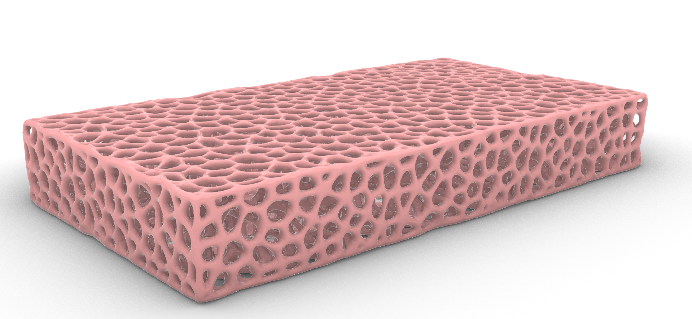
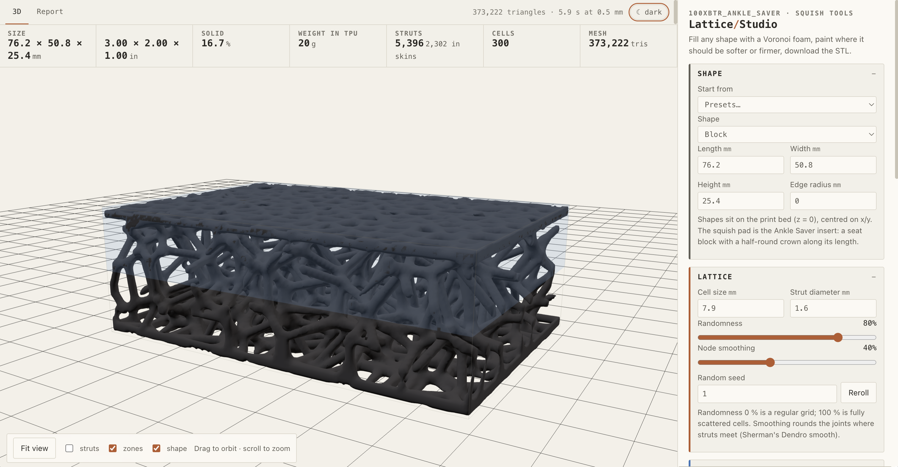
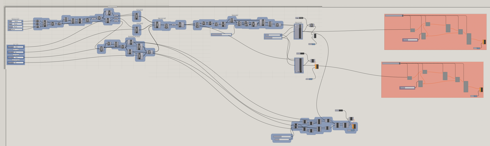

# Voronoi Lattice

[← all Grasshopper projects](../)

A Grasshopper definition that fills a block with a Voronoi foam: an open, sponge-like lattice with denser top and bottom
skins, thickened into smooth struts and meshed, ready to 3D print.

**Web version:** Will Rollins built a web version from this script:
[Lattice Studio](https://will.100xbtr.com/lattice/). Fill any shape with a Voronoi foam, paint where it should be softer
or firmer, and download the STL.

## Requirements

- Rhino 8 with Grasshopper
- Plugins: [Dendro](https://www.food4rhino.com/en/app/dendro) (volume and mesh), [Pufferfish](https://www.food4rhino.com/en/app/pufferfish), OCORE Toolbox

Open Rhino, run `Grasshopper`, then open `lattice_vornoi5.gh`.

## Inputs

| Group | Sliders |
|---|---|
| **sponge size input** | `width`, `length`, `thickness` |
| **volume density** | `point density` for the core |
| **top skin density**, **bottom skin density** | `point density` for each face |
| **change this for pipe sizes** | `pipe radius factor`, `radius` |
| **change this for mesh density** | Dendro mesh settings |
| clean-up | `tolerance for regrouping` (the minimum distance between node groups), `offset from surface` |

Groups marked `DONT CHANGE` hold the internal logic.

## How it works

1. **Points.** Points are scattered inside the bounding box (`make points in bb`), with separate densities for the volume
   and for the top and bottom skins (`top and bottom point density`), so the faces come out denser than the core. Then
   they are filtered (`filter points`).
2. **Cells.** Voronoi cells are built around the points (`make voronoi cells`).
3. **Clean lines.** The cell edges become a list of lines. Nodes closer than the regrouping tolerance are merged and
   duplicate lines removed (`list of unique lines`, `prevent spikes`), so the lattice has clean joints.
4. **Struts.** The lines are thickened into a smooth volume with Dendro and meshed (`makes the pipes`), with
   `pipe radius factor` for strut size and a mesh density setting for resolution. A blockier pipe option
   (`makes the pipes (more blocky)`) is there for faster previews.
5. **Output.** The result is a single mesh sponge (`make sponge geometry`), ready to export and print.

The canvas image is stitched together from zoomed-in screenshots so the whole definition reads at full size.

## Files

- `lattice_vornoi5.gh`: the Grasshopper definition
- `images/`: render, canvas and the web version
